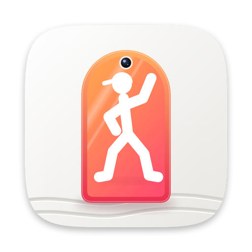

<p align="center"></p>

<h1 align="center">DisplayCam</h1>

<p align="center"><b>手机当眼睛，显示器当镜子。</b><br>
把闲置的 Android 手机对着自己，画面实时显示在 Mac 的显示器上。专为跟练跳舞设计。</p>

<p align="center">
  <a href="https://hanqing.github.io/DisplayCam/">官网</a> ·
  <a href="https://github.com/Hanqing/DisplayCam/releases/latest">下载</a>
</p>

## 功能

- **实时镜像**：USB 有线连接，硬件编解码，画面左右翻转，跟真镜子一样
- **延迟回放**：显示 1–15 秒前的自己；分屏模式左边实时、右边延迟
- **录制**：随时开始录制，或一键「保存刚才 15 秒」，同时录下手机麦克风的声音
- **录像库**：按时间整理，带缩略图，双击播放
- **为 macOS 26 打造**：Liquid Glass 界面，菜单栏控制，镜子显示时屏幕不休眠
- 手机息屏也能用；4:3 画面在手机横放时拍得到全身；断开后自动重连

## 系统要求

- macOS 26 或更高版本（Apple 芯片）
- Android 12 或更高版本的手机，已打开「USB 调试」
- Mac 上安装 adb：`brew install --cask android-platform-tools`

## 使用

1. 从 [Releases](https://github.com/Hanqing/DisplayCam/releases/latest) 下载 `DisplayCam.zip`，解压后拖进「应用程序」。
   App 没有经过 Apple 公证，第一次打开时，到「系统设置 › 隐私与安全性」里点「仍要打开」。
2. 手机打开 USB 调试，用数据线连上 Mac，在手机上点「允许」。
3. 手机横放、后置镜头对着自己。点「打开镜子」，画面会全屏显示在你选择的显示器上。

| 快捷键（镜子窗口） | 作用 |
|---|---|
| M | 镜像开关 |
| D | 切换视图：实时 / 延迟 / 分屏 |
| ← / → | 延迟时间 −/+ 0.5 秒 |
| 空格 | 开始 / 停止录制 |
| S | 保存刚才的片段 |
| R | 旋转 90° |
| F 或双击 | 全屏 / 窗口 |
| Esc | 关闭镜子窗口 |

主窗口里：⌘R 录制，⌘S 保存刚才，⌘1/2/3 切换视图，⇧⌘M 打开镜子。

## 自己编译

只需要 Command Line Tools（Swift 6.2+）：

```bash
./scripts/build-app.sh        # 生成 build/DisplayCam.app
open build/DisplayCam.app
```

装了 Xcode 并同意了许可协议时，打包脚本会额外编译 Icon Composer 图标（`design/icon/AppIcon.icon`），在 macOS 26 上显示 Liquid Glass 效果。图标源文件由 `design/icon/make_icon.py` 生成，运行 `design/icon/build_icon.sh` 重新生成。

## 原理

```
手机：scrcpy-server（Camera2 采集 → MediaCodec 硬件编码 H.264；麦克风 → AAC）
  │  USB · adb forward
Mac：StreamSession（scrcpy 协议）→ MediaPipeline
       ├─ 实时显示层（镜子窗口、主窗口预览）
       ├─ 最近 1 分钟压缩帧 → 延迟显示层
       └─ Recorder（AVAssetWriter 直接封装 MP4，不重新编码）
```

| 文件 | 内容 |
|---|---|
| `ADB.swift` / `ScrcpyServer.swift` | 调用 adb，手机端服务参数、摄像头列表、电量 |
| `StreamSession.swift` | 一次连接：推送并启动服务，读取视频和音频流 |
| `H264.swift` / `AAC.swift` | 码流转换为 CoreMedia 帧，音视频时钟对齐 |
| `MediaPipeline.swift` | 实时画面、延迟回放、录制的分发 |
| `Recorder.swift` / `RecordingsStore.swift` | 写 MP4，管理录像库 |
| `MirrorView.swift` | 镜子画面（镜像、旋转、分屏）和镜子窗口 |
| `MainWindow.swift` / `SettingsView.swift` / `App.swift` | 界面 |

开发调试：`DISPLAYCAM_DEBUG=1` 输出帧率和渲染日志；`DISPLAYCAM_SELFTEST=<目录>` 自动执行录制流程并把窗口截图保存到该目录。

## 致谢

手机端使用 [scrcpy](https://github.com/Genymobile/scrcpy) 5.0.1 的 `scrcpy-server`（Apache 2.0，见 `Resources/LICENSE-scrcpy`）。客户端协议和版本绑定，升级时要同时替换 `Resources/scrcpy-server` 并修改 `ScrcpyServer.version`。
